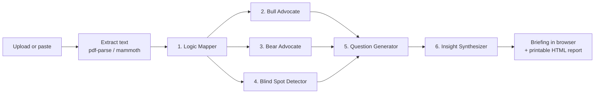

# Unseen

Six AI agents tear apart any strategy document and synthesize it into one executive briefing, for founders, advisors and boards who want the hard questions before the meeting, not during it.


<!-- screenshot: add docs/screenshot.png -->

## What it does

- **Reads your document**: upload a PDF, DOCX, TXT or MD file (up to 10 MB), or paste text.
- **Runs an adversarial review**: six specialised Claude agents argue for it, against it, and around it.
- **Finds the blind spot**: names the assumption the team is protecting from scrutiny.
- **Asks the unasked questions**: five sharp questions, each with why it's avoided and why it matters.
- **Writes the briefing**: a 3-paragraph executive summary, plus a printable HTML report you can save as PDF.

## The six agents

| # | Agent | What it outputs |
|---|-------|-----------------|
| 1 | **Logic Mapper** | JSON: core claim, 5 key assumptions, 3 hidden assumptions, 3 critical dependencies, 3 structural weaknesses |
| 2 | **Bull Advocate** | 4–5 paragraphs steelmanning the strategy: thesis, market dynamics, hidden strengths, timing, upside |
| 3 | **Bear Advocate** | 4–5 paragraphs on how it fails: primary failure mode, fragile assumptions, competition, execution risk, worst case |
| 4 | **Blind Spot Detector** | The blind spot (1 sentence), why they can't see it, what would change if challenged |
| 5 | **Question Generator** | JSON: exactly 5 questions, each with `why_unasked` and `why_it_matters` |
| 6 | **Insight Synthesizer** | 3-paragraph executive summary: what the strategy aims for, the single most important finding, the recommended next action |

Each agent's system prompt is grounded in a built-in knowledge base (fallacies, failure patterns, benchmarks) in `src/knowledge_base.js`. If one agent fails, it returns a fallback and the rest of the run continues.

## How it works



Agents run one after another in the numbered order; each later agent receives the earlier agents' output (the Synthesizer sees all of it). The browser polls a job endpoint for progress while the analysis runs.

## Quickstart

Requires Node.js 18+ and an [Anthropic API key](https://console.anthropic.com/).

```bash
git clone https://github.com/0jz/Unseen.git
cd Unseen
npm install
cp .env.example .env        # Windows cmd: copy .env.example .env
# edit .env and set ANTHROPIC_API_KEY=<your-anthropic-key>
npm start
```

Open http://localhost:3000. To try it without your own document, paste the contents of `test_document_flowdesk.txt` (a sample Series A fundraising plan).

## Configuration

| Variable | Required | Default | Description |
|----------|----------|---------|-------------|
| `ANTHROPIC_API_KEY` | Yes | – | Your Anthropic API key |
| `PORT` | No | `3000` | Port the Express server listens on |

The model is set in `src/agents.js` (`MODEL = 'claude-sonnet-4-6'`).

## Usage

1. Enter a client name (shown on the report cover).
2. Pick an analysis type: **Strategic Review**, **Risk Assessment**, **Pivot Analysis**, **Market Entry Analysis**, **Fundraising Strategy Review** or **Board Meeting Preparation**.
3. Upload a file or paste text, then run the analysis.
4. Read the briefing in the browser, or open the export view and use **Print / Save PDF**.

### What the briefing contains

Executive summary · Logical structure (core claim, key and hidden assumptions, dependencies, weaknesses) · Bull case vs. bear case side by side · Blind spot analysis · Five unasked questions. The JSON report (`/api/report/:jobId`) also includes metadata: model, timestamp, token usage and estimated cost.

### API

| Method | Endpoint | Purpose |
|--------|----------|---------|
| `GET` | `/api/ping` | Health check; reports whether the API key is set |
| `POST` | `/api/analyze` | Multipart form: `document` (file) or `pastedText`, plus `analysisType`, `clientName`. Returns `{ jobId }` |
| `GET` | `/api/status/:jobId` | Job status, progress (0–100) and current stage |
| `GET` | `/api/report/:jobId` | Finished report as JSON |
| `GET` | `/api/report/:jobId/export` | Printable HTML report |

## Project structure

```
server.js               # Express server, upload handling, job store, API routes, HTML export
src/agents.js           # The six agents, prompts, model id, orchestration
src/knowledge_base.js   # Reference knowledge injected into each agent's prompt
src/extractor.js        # Text extraction for PDF / DOCX / TXT / MD
public/                 # Static frontend (index.html, css/style.css, js/app.js)
test_document_flowdesk.txt  # Sample input document
unseen_full_plan.html   # Project plan / design notes
```

## Status & limitations

- Hackathon-stage project: no auth, no tests, no database.
- Jobs live in memory and are lost on restart; jobs and uploaded files are cleaned up after 24 hours.
- Long documents are trimmed (beginning + end kept) to fit each agent's prompt budget.
- The cost shown on the report is an estimate at $3 / $15 per million input / output tokens.
- A full run makes six sequential Claude calls, so expect it to take a while.
- Output quality depends entirely on the model; treat the briefing as a sparring partner, not a verdict.

## License

No license file is included yet. Until one is added, all rights are reserved by the author.
